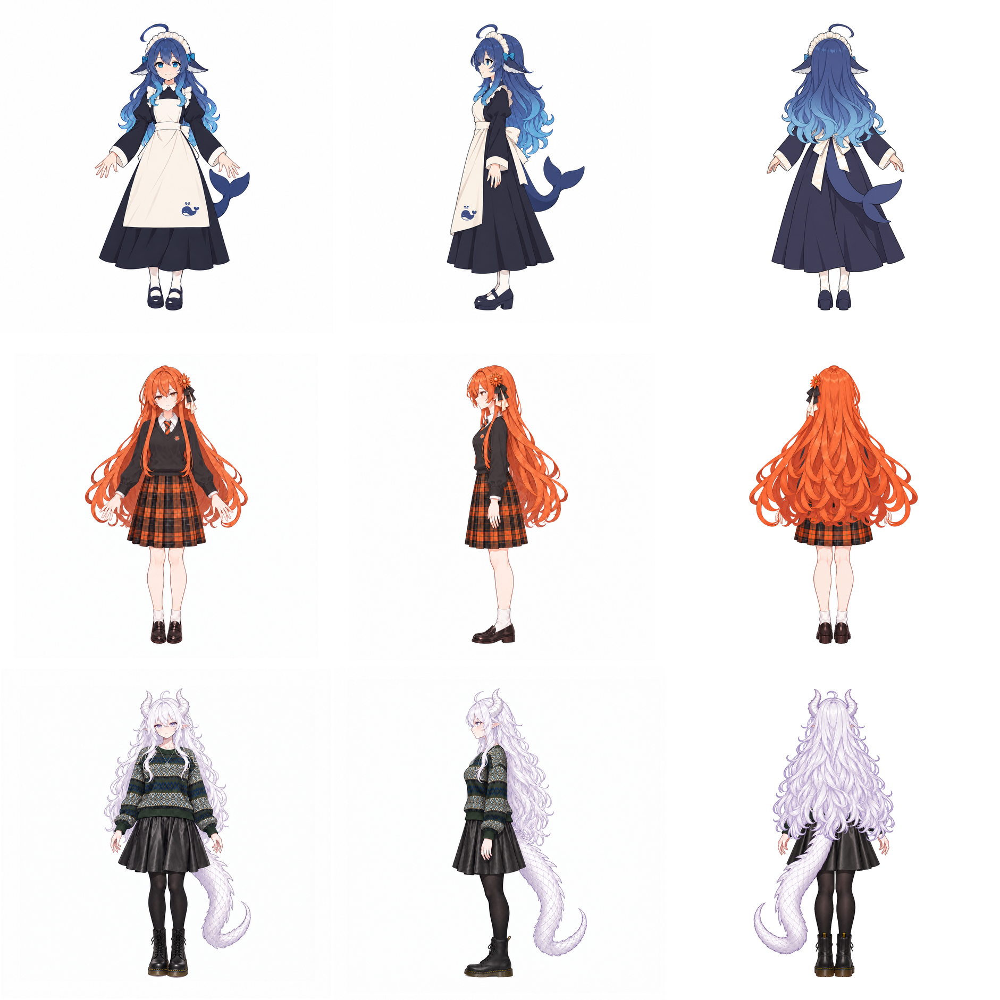

# AI Character Assets

DeepSeek、Claude、GPT 社区拟人形象的已定稿二维资产。由 **chouseiu-ai** 选型、修改方向与审校，使用 Codex 内置图像生成及局部分层合成完成。

本仓库公开提供**非商业同人资产**。角色不是相关公司的官方人设；插画、品牌名称与商标的权利和使用范围见 [NOTICE](NOTICE.md)、[来源与许可核实](docs/ASSET_SOURCES.md) 和 [LICENSE](LICENSE)。

| 角色 | 定稿服装 | 三视图 | 独立素材 |
| --- | --- | --- | --- |
| DeepSeek | 朴素深蓝长裙女仆、蓝发、鲸尾 | [正面](DeepSeek/front.png) / [左侧](DeepSeek/left.png) / [背面](DeepSeek/back.png) / [合图](DeepSeek/three-view.png) | [五指精修细节](DeepSeek/assets/hand-details/) |
| Claude | 橙发、JK 毛衣与橙黑格纹裙 | [正面](Claude/front.png) / [左侧](Claude/left.png) / [背面](Claude/back.png) / [合图](Claude/three-view.png) | [刺绣章](Claude/assets/embroidery/) / [完整后发、躯干分层](Claude/assets/back-layers/) |
| GPT | 银白龙娘、墨绿毛衣、黑皮裙、棉袜、1460 靴 | [正面](GPT/front.png) / [左侧](GPT/left.png) / [背面](GPT/back.png) / [合图](GPT/three-view.png) | [金属项链](GPT/assets/necklace/) / [完整后发、躯干分层](GPT/assets/back-layers/) |

## 规格和使用

- 单张 `1254×1254`，无损 RGB PNG；合图 `3762×1254`，顺序为正面、左侧、背面。三张完整画布直接拼接。
- 标准画布中，主体轴约 `x627`、自然发顶约 `y120`、鞋底约 `y1167`。龙角和呆毛不作为身高缩放基准。
- `*-master.png` 保存独立生成的完整透明素材；`hair-layer.png` / `body-layer.png` 是对齐后的透明层，先放躯干，再把头发置顶。
- 刺绣章和项链均保存原素材、原画坐标图层与标准坐标图层。用法见各素材目录的 README。
- [独立素材总览](independent-assets-preview.png)、[素材清单](asset-index.csv)、[校验文件](SHA256SUMS.txt)。
- 安装 Pillow 后运行 `python recompose.py` 可在新的 `recomposed/` 目录复现 Claude/GPT 的正、背面；不覆盖定稿。

`Approved-archives/` 另存此前确认的 Claude 长裙正面、GPT 航天服正面以及认可的素材参考。当前定稿以三个角色主目录为准。

## 署名和许可

- **DeepSeek**：原鲸鱼娘角色来自 **上善无形 / 上善**，DeepSeek 女仆二次设计来自 **ZipZipPipe**。本项目在相关权利范围内沿用 **CC BY-NC-SA 4.0**：署名、非商业、改编同协议。完整链和本次改动见 NOTICE。
- **Claude / GPT**：原型来自 **ZipZipPipe《AI娘化》**，经 `WPH666-py/AI-Family-Skin-Suit3` 找到。原作者要求署名、非商业使用；其描述将 CC BY-NC-SA 4.0 明确用于 DeepSeek，本仓库没有将这项 CC 声明扩展到其他角色。
- 商标和公司名称仍属于各自权利人。刺绣章与金属项链的制作不授予官方 logo 的商标权，也不表示官方合作或背书。

本次 GitHub 归档没有重新生成图像。原素材与定稿图逐字节保留，制作提示词和合成记录随各角色目录存档。关于代码、美术和品牌标识的不同范围，以 LICENSE 和 NOTICE 为准。
